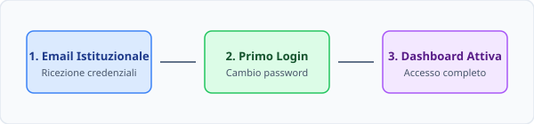

# Primo accesso alla piattaforma

Per accedere alla piattaforma Edulogia per la prima volta, segui attentamente questi passaggi:

1. Apri il browser web e collegati all'indirizzo principale del portale istituzionale.
2. Inserisci il tuo indirizzo email istituzionale nel campo **Utente**.
3. Digita la password temporanea che hai ricevuto nella casella di posta di benvenuto.
4. Clicca sul pulsante **Accedi**.

> [!IMPORTANT]
> Al primo accesso ti verrà chiesto obbligatoriamente di impostare una nuova password personale di almeno 10 caratteri, contenente lettere maiuscole, minuscole e numeri.

## Requisiti delle credenziali

| Campo | Formato richiesto | Esempio |
| :--- | :--- | :--- |
| **Utente** | Email istituzionale attiva | `mario.rossi@scuola.edu.it` |
| **Password temporanea** | Codice alfanumerico di 8 caratteri | `Ed9#kL2p` |
| **Nuova password** | Minimo 10 caratteri con 1 numero e 1 simbolo | `Scuola2026!Sicura` |

> [!TIP]
> Conserva le credenziali in un gestore di password sicuro ed evita di riutilizzare la stessa password impiegata su altri servizi personali. In caso di smarrimento, consulta la [procedura di recupero della password](./recupero-password.md).
