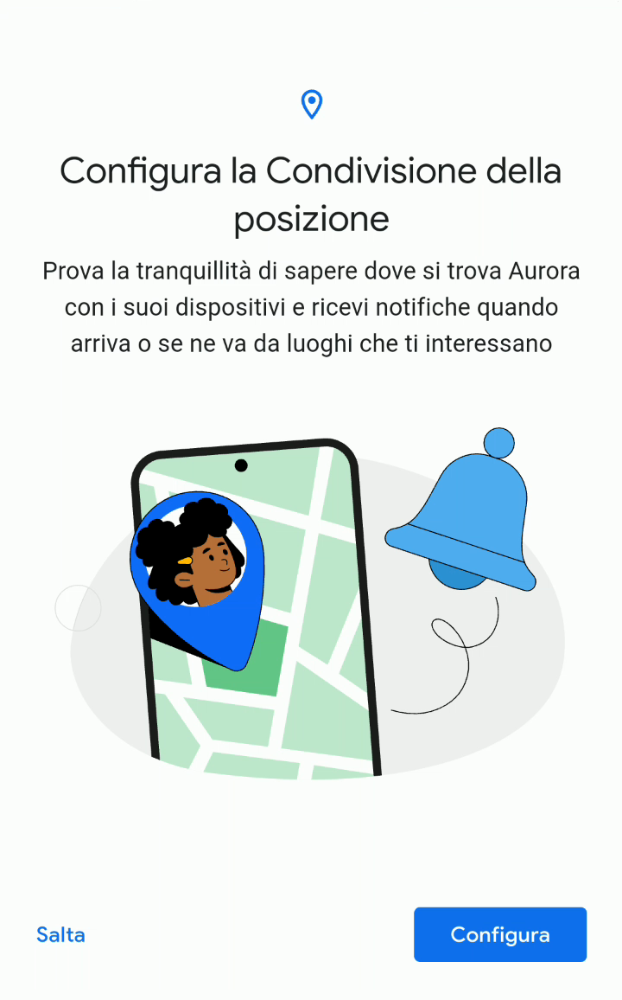
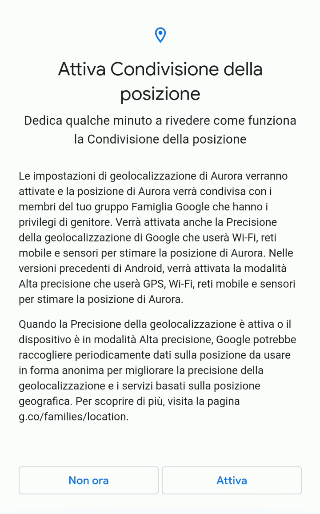
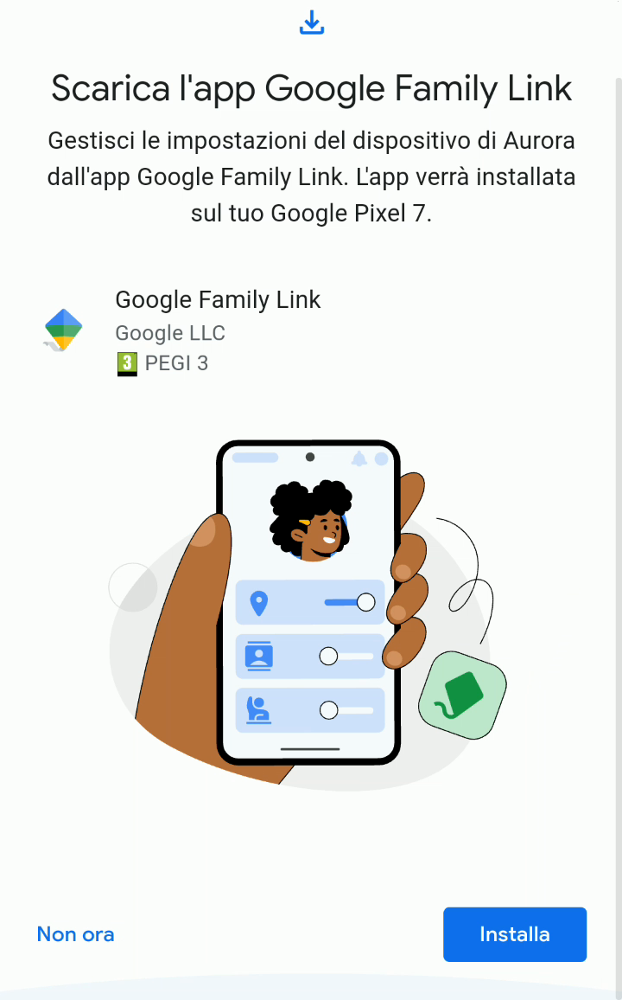
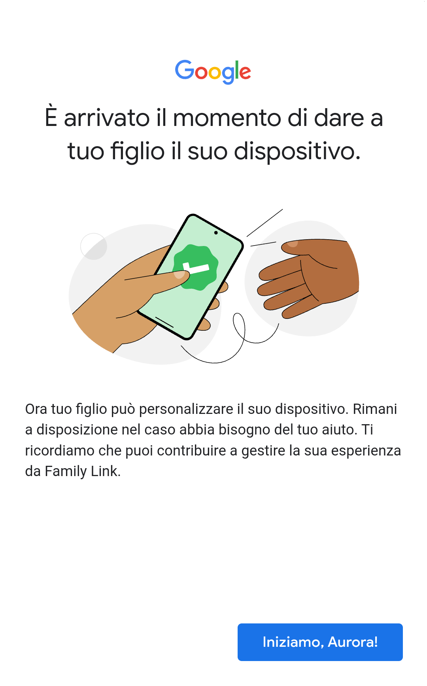

# Attivare la condivisione della posizione e completare la configurazione

Ultimo passo della configurazione del cellulare è quello di decidere se abilitare la [condivisione della posizione](https://support.google.com/families/answer/7103413?hl=it). La scelta è molto soggettiva.

> [!NOTE]
> Per esempio, se il cellulare sarà usato solo a casa, condividere la posizione è inutile. Se il cellulare sarà usato senza una scheda SIM, anche in questo caso la condivisione della posizione non funzionerà, dato che il cellulare saprà dove si trova, ma non avrà il collegamento ad Internet per condividere la sua posizione con il resto del gruppo famiglia.

1. Come per le altre configurazioni, anche questa sulla condivisione della posizione si può saltare. Se invece vuoi abilitarla, seleziona “Configura”.

   

2. Seleziona “**Attiva**” per attivarla, oppure “Non ora” per attivarla in un secondo momento tramite l’app Family Link.

   

3. Ci viene ricordato che per gestire tutte le impostazioni del cellulare di nostro figlio/a occorre installare l’app Family Link sul nostro cellulare genitore, e il bottone “Installa” permette di farlo, se non è già stato fatto.

   

4. Finalmente, la configurazione è terminata, e possiamo dare il cellulare a nostro figlio/a.

   

Da questo momento in poi, l’app Family Link registrerà come tuo figlio/a usa il cellulare, quali app vengono utilizzate e per quanto tempo, e permetterà di cambiare tutte le impostazioni che abbiamo visto fino ad ora, e anche diverse altre.

Potrai quindi decidere, grazie ad un dialogo aperto con tuo figlio/a, come lui/lei potrà usare il suo cellulare. **Iterativamente** e **gradualmente**.
