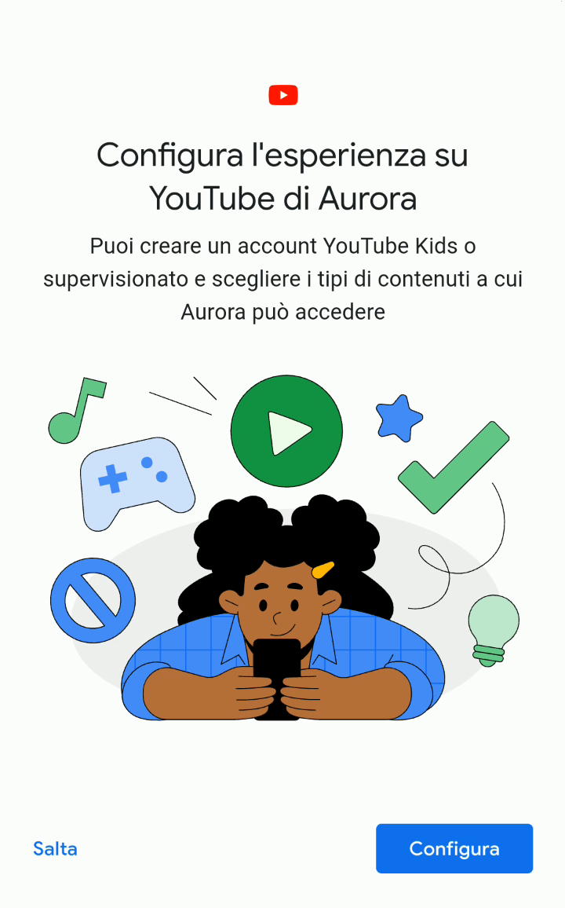
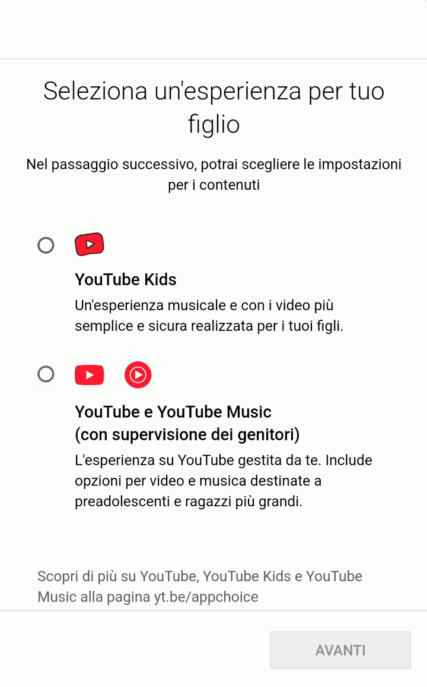
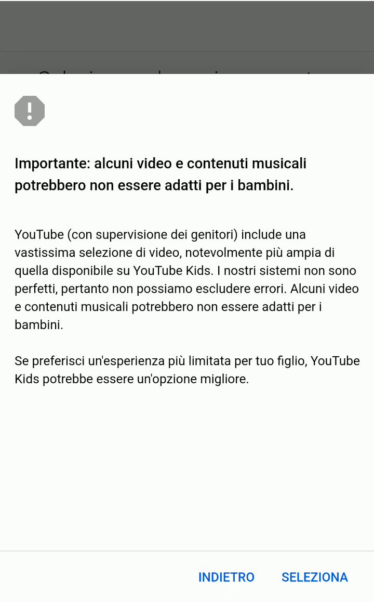
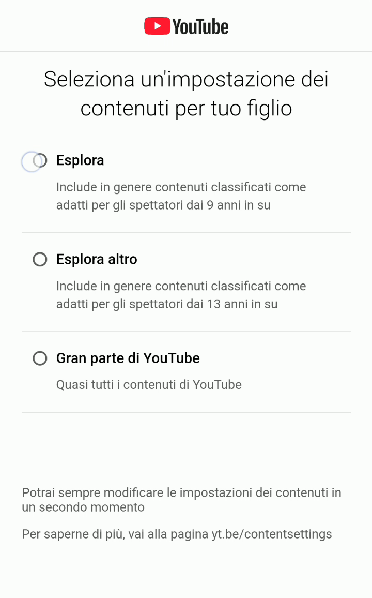
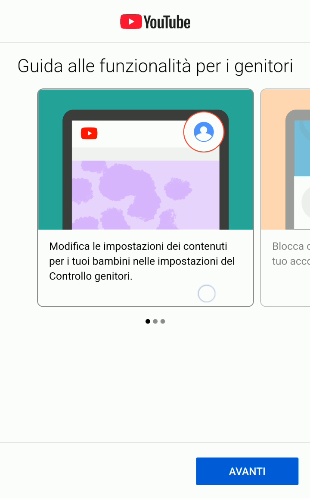
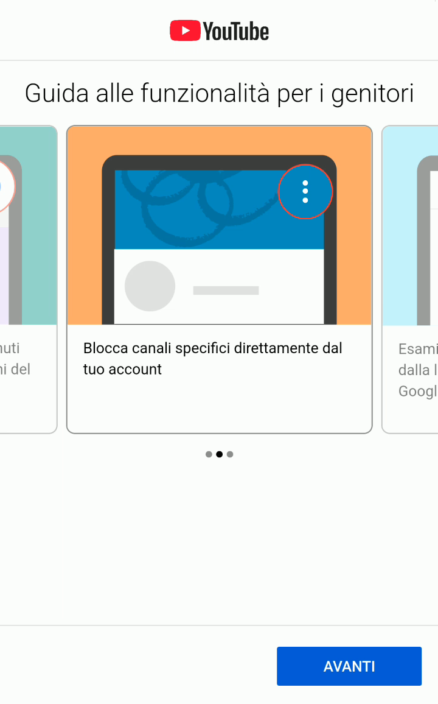
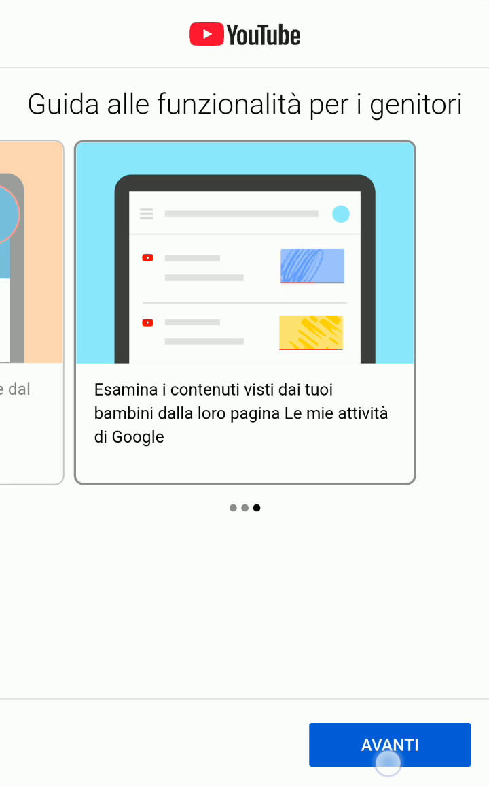
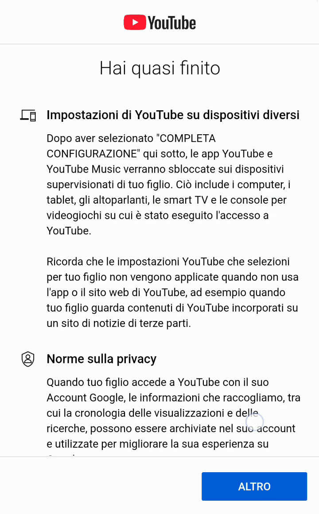
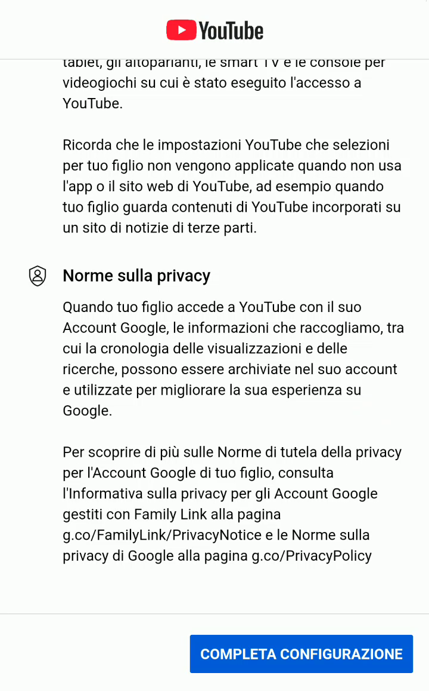

# Configurare YouTube Kids o YouTube con supervisione

Continuando con la prima configurazione del cellulare, puoi impostare che tipo di esperienza YouTube offrire a tuo figlio/a, sempre che tu voglia abilitare questa applicazione.

1. Per offrire un’esperienza più controllata su YouTube, seleziona il bottone “Configura”.

   > [!WARNING]
   > Puoi completamente saltare questa sezione e dare accesso senza filtri a tutto YouTube, cosa che sconsiglio altamente.

   

2. Innanzitutto devi scegliere se sul cellulare sarà disponibile solo YouTube Kids (*una versione “ridotta e più protetta” di YouTube solo con video pre-selezionati e adatta ai bambini fino ai 4 anni, dai 5 agli 8 anni, fino ai 12 anni*), oppure la versione “normale” di YouTube, ma con delle restrizioni.

   

3. Se scegli “YouTube e YouTube Music”, leggi con attenzione l’avviso sulle limitazioni dei filtri basati sull’età.

   > [!IMPORTANT]
   > Nonostante la possibilità di filtrare alcuni video, il catalogo disponibile su YouTube e YouTube Music è molto vasto e non sempre è possibile verificare l’età minima davvero adatta a guardare i video. Questo perché chi pubblica i video indica l’età minima per cui sono adatti, e quindi c’è sempre una certa soggettività nella scelta dell’età, diciamo così.

   

4. Se si seleziona “YouTube e YouTube Music” si può scegliere l’età minima dei video disponibili: fino a 9 anni, dai 13 anni in su, oppure quasi tutti i video di YouTube. Seleziona una delle tre opzioni disponibili, leggi il dettaglio di cosa viene incluso, e conferma usando il bottone “**Seleziona**”.

   

5. Vengono infine ricordate alcune delle configurazioni che puoi fare a posteriori tramite l’app Family Link: cambiare il livello di età dei contenuti disponibili per tuo figlio/a…

   

6. Bloccare specifici account o canali…

   

7. Controllare i video visualizzati da tuo figlio/a nella loro pagina “Le mie attività di Google”.

   

8. Un ultimo controllo di cosa realmente controllano le opzioni impostate fino a questo punto.

   

9. Premi “**Completa Configurazione**” una volta letto il contenuto di questa schermata.

   
