# Creare un account Google per un figlio con meno di 14 anni

Se tuo figlio ha meno di 14 anni (età minima richiesta in Italia) e non ha un account Google, o se preferisci usare un nuovo account per gestire il dispositivo, puoi crearne uno tramite l'app Family Link.
Potresti anche creare l'account durante la [configurazione del cellulare](./primo-avvio-cellulare-figlio.md), i passaggi sono praticamente gli stessi.
In entrambi i casi, **non occorre** avere **un numero di telefono** associato al cellulare del figlio.

1. Nell'app Family Link, seleziona "**Aggiungi tuo figlio**".

   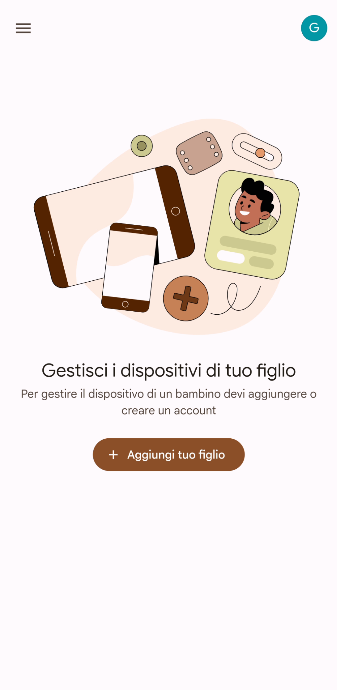

2. Seleziona "**No**" per iniziare a creare un nuovo account per tuo figlio/a.

   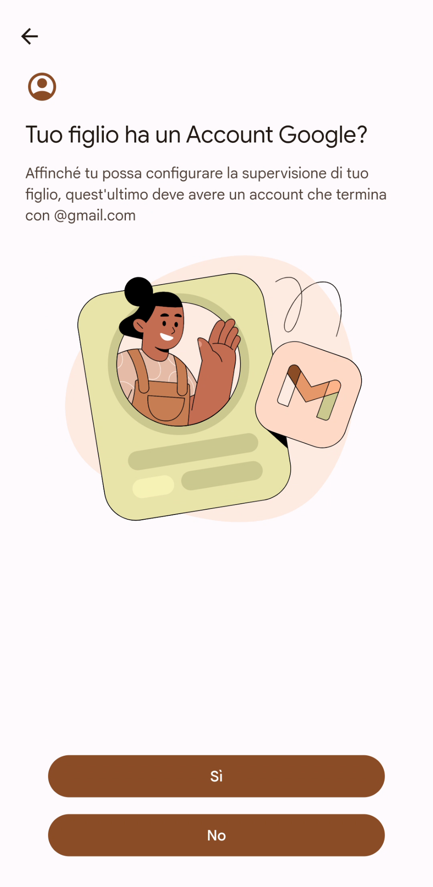

3. Leggi i prossimi passi da fare, e poi seleziona "**Avanti**".

   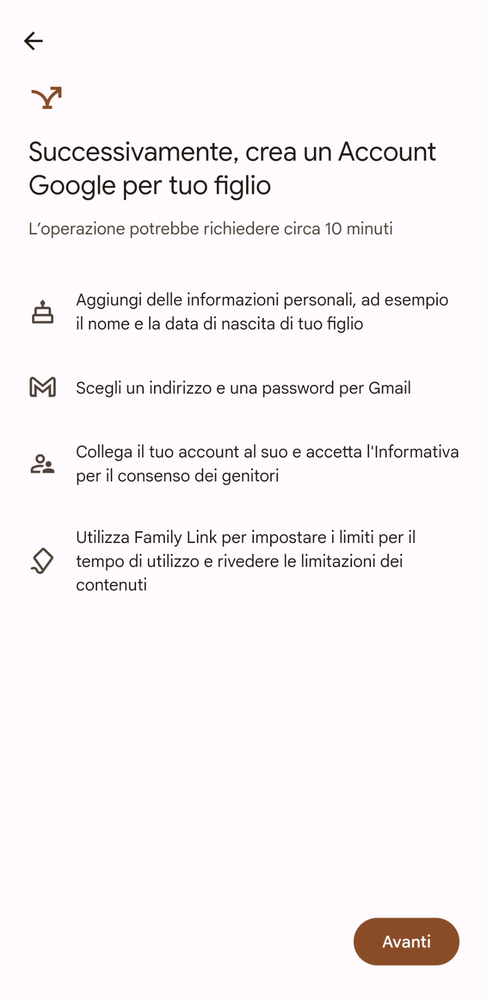

4. Scrivi il nome di tuo figlio/a. *Io come esempio ho scelto Aurora.* Se vuoi, indica anche il cognome. Poi seleziona "**Avanti**".

   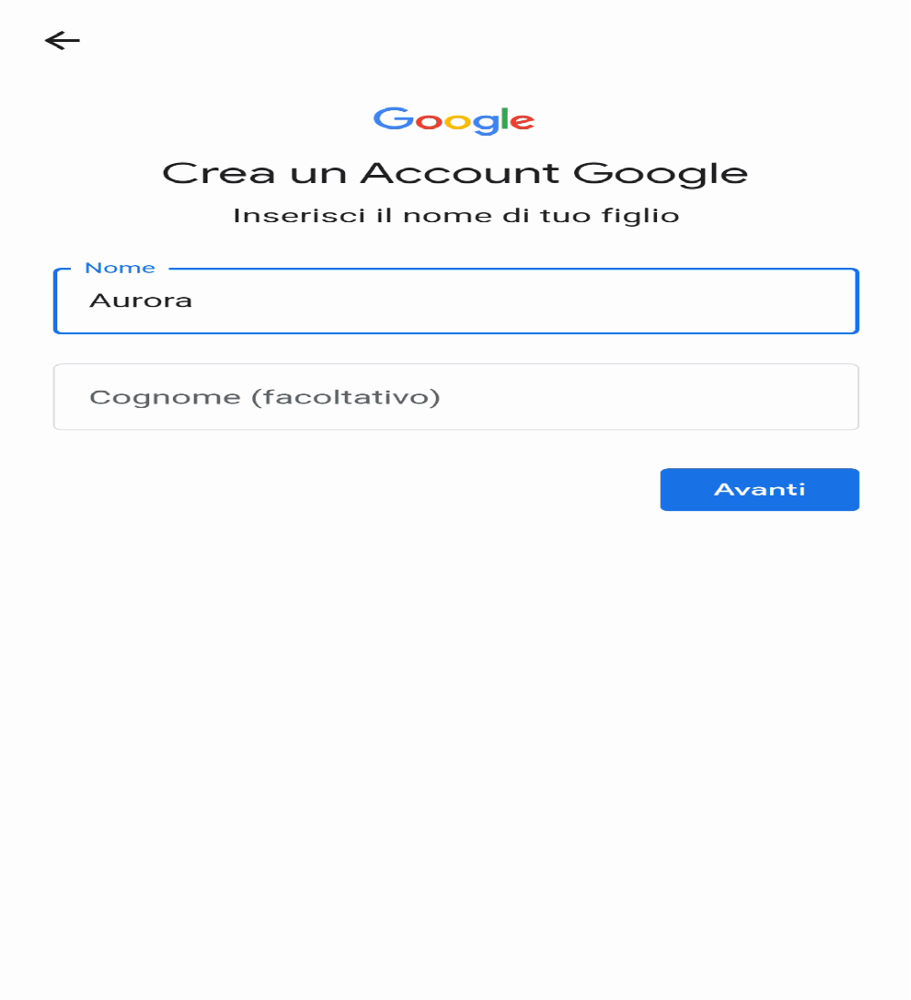

5. Inserisci la data di nascita. Soprattutto l'**anno è importante per calcolare l'età**, dato che verrà usato per gestire l'accesso a contenuti e applicazioni (lo vedremo più avanti). Indica, se vuoi, il genere di tuo figlio/a. Poi seleziona "**Avanti**".

   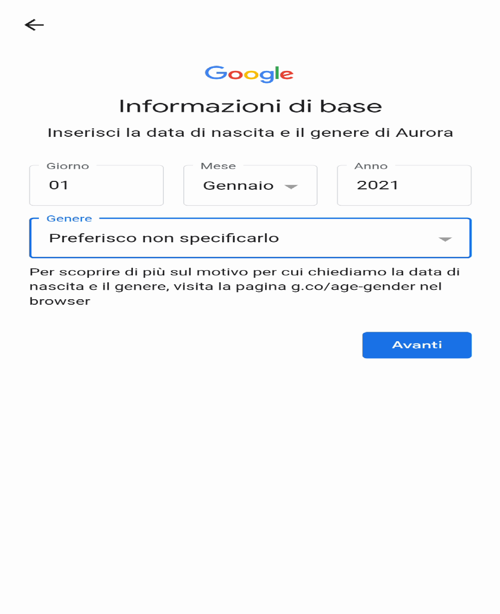

6. Scegli un indirizzo email da assegnare a tuo figlio/a, e poi seleziona "**Avanti**". *Io, per questo esempio, ho scelto di creare un account chiamato famiglia.figlio.aurora@gmail.com*.

   > [!IMPORTANT]
   > Questa fase è molto importante: **scegli con cura l'indirizzo email** da assegnare a tuo figlio/a. Non potrai cambiarlo una volta scelto, e verrà usato in molti altri posti. Se per caso l'indirizzo email esiste già, ti verrà chiesto di sceglierne uno diverso.

   

7. Scegli una password per accedere all'account di tuo figlio. Poi seleziona "**Avanti**".

   > [!WARNING]
   > Usa una **password diversa da quella del tuo account da genitore**, altrimenti tuo figlio/a potrebbe facilmente scavalcare tutti i controlli.

   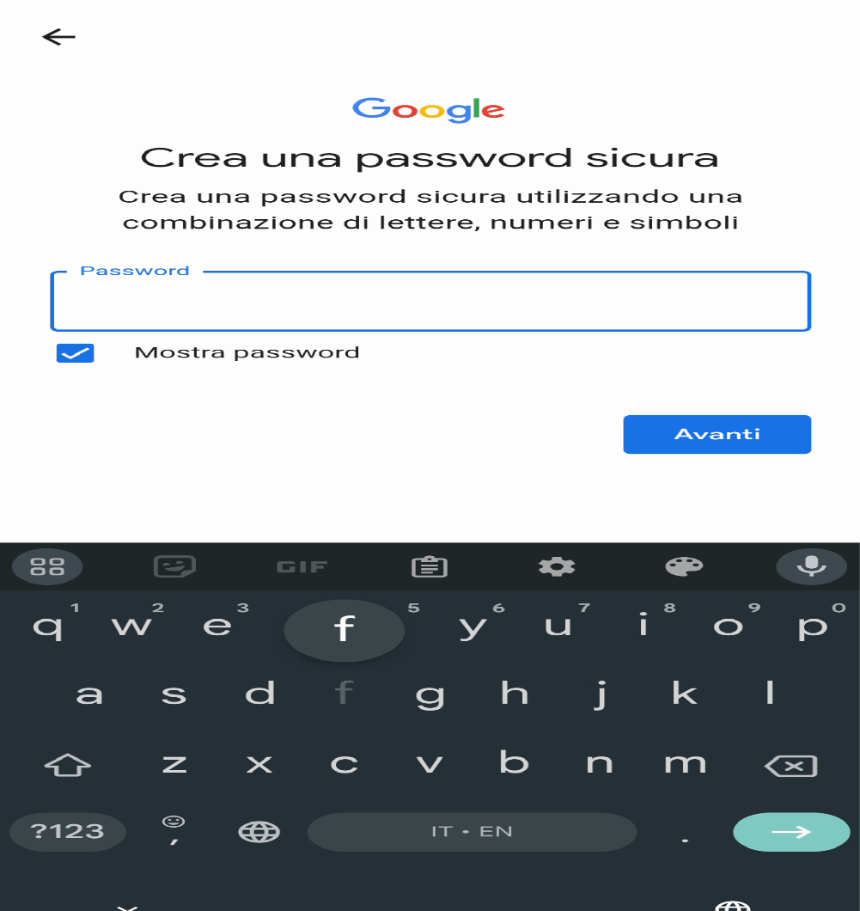

8. Google ti chiederà un numero di telefono a cui manderà un SMS per verificare che sia davvero una persona a creare l'account. Usa pure il tuo numero di telefono da genitore. *Questo numero di telefono serve solo in questa fase, e non verrà associato all'account figlio/a.* Poi seleziona "**Avanti**".

   

9. Inserisci il codice di verifica che ti è arrivato via SMS. Poi seleziona "**Avanti**".

   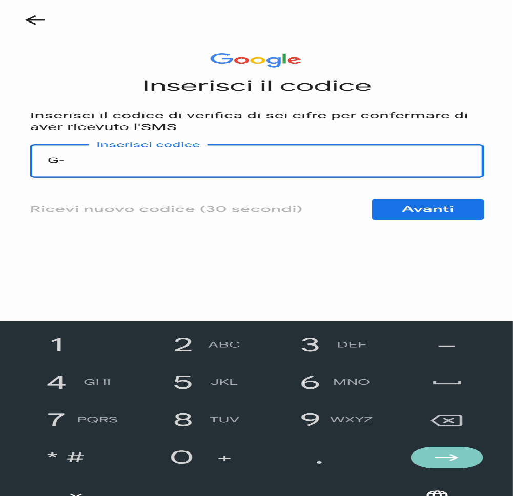

10. Leggi un po' di informazioni che ti spiegano come usare l'account di tuo figlio/a. Lo so che c'è molto da leggere, ma sono tutte informazioni utili. Scorri in basso.

    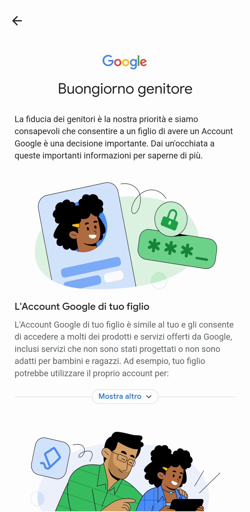

11. Fornisci i tuoi consensi per creare l'account di tuo figlio/a, e associarlo al gruppo famiglia. Poi seleziona "**Avanti**".

    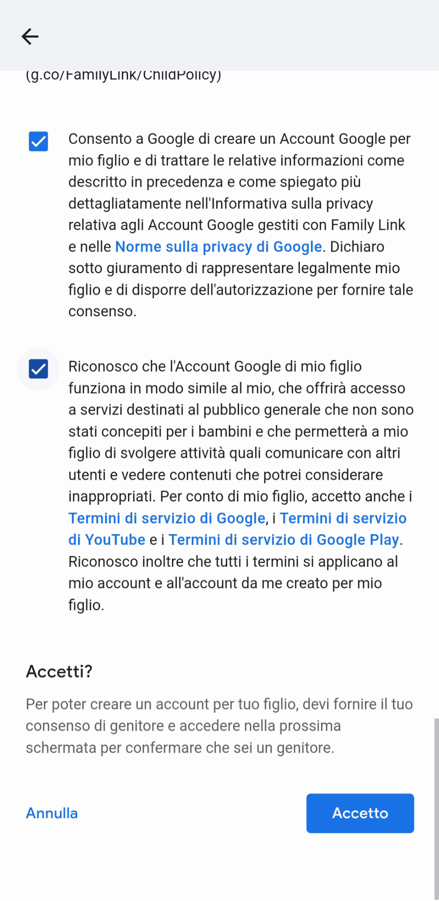

12. Adesso ti verrà chiesto di confermare che è il genitore che ha fatto tutte le precedenti operazioni. Potresti dover mettere la tua password genitore (*e non quella che hai specificato prima nella creazione dell'account di tuo figlio/a*), oppure usare un metodo biometrico, tipo impronta o volto, oppure in altri modi. Dipende da come è configurato il tuo cellulare.

    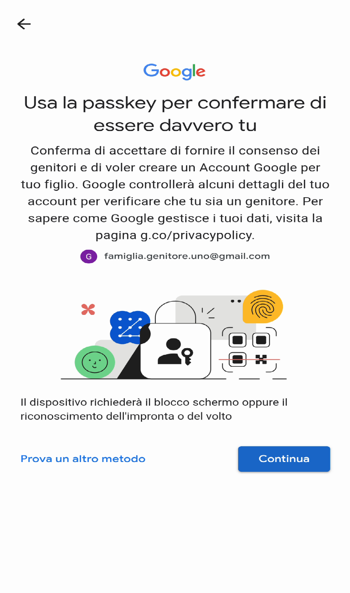

13. Ci siamo quasi. In questa schermata viene chiaramente detto cosa potrai gestire come genitore relativamente all'account di tuo figlio/a.

    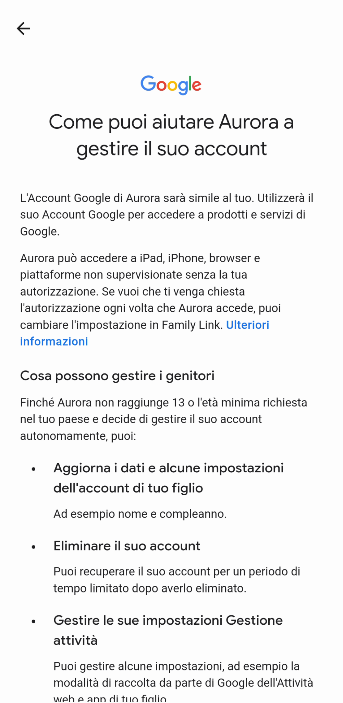

14. Leggi tutto e poi seleziona "**Avanti**".

    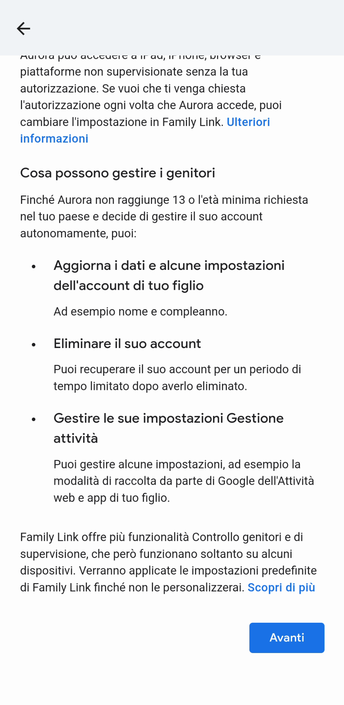

15. Potresti dover verificare che sei davvero un adulto. Non sempre questo controllo è richiesto, perché magari Google ha già verificato in passato che il tuo account genitore appartiene veramente ad un adulto. Il motivo è semplice: un minore abbastanza "furbo" potrebbe creare un finto account genitore da usare per gestire il gruppo famiglia.

    > [!IMPORTANT]
    > Se vedi questo passaggio, ti verrà chiesto di **usare una carta di credito** per fare una transazione di 0€. Se ti viene chiesto di farlo, è un passo necessario, purtroppo, e non si può evitare. Seleziona "**Avanti**" e segui le istruzioni per effettuare il pagamento di test.

    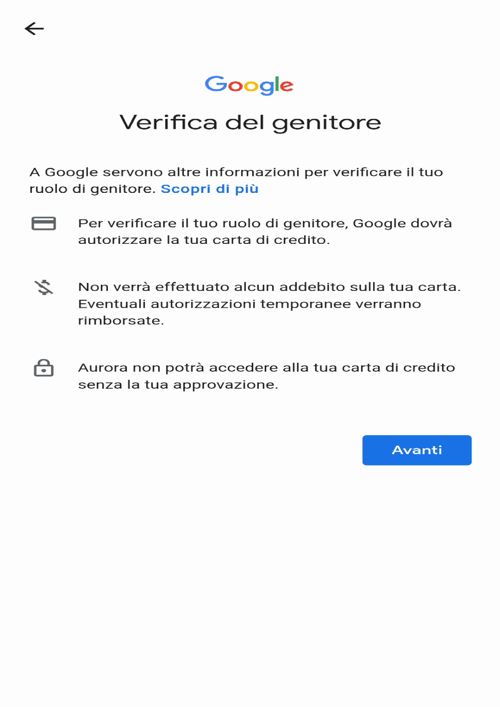

16. Finalmente! Il tuo nuovo account figlio è stato creato, è stato associato al gruppo famiglia, e puoi vederlo nell'app Family Link.

    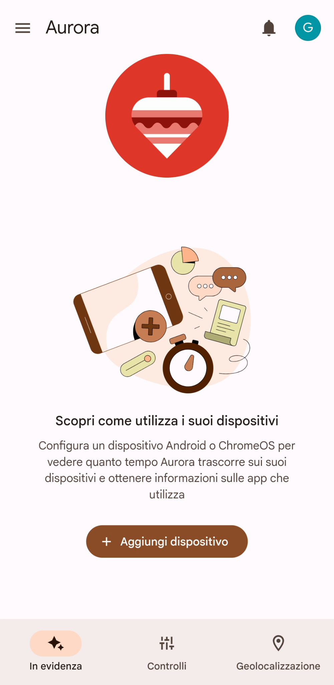

Ora puoi [configurare il cellulare](./primo-avvio-cellulare-figlio.md) usando l'account di tuo figlio/a.
