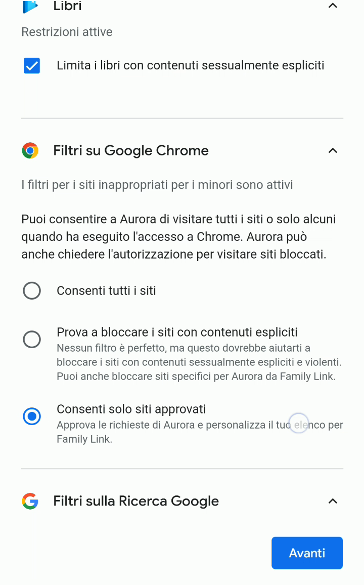
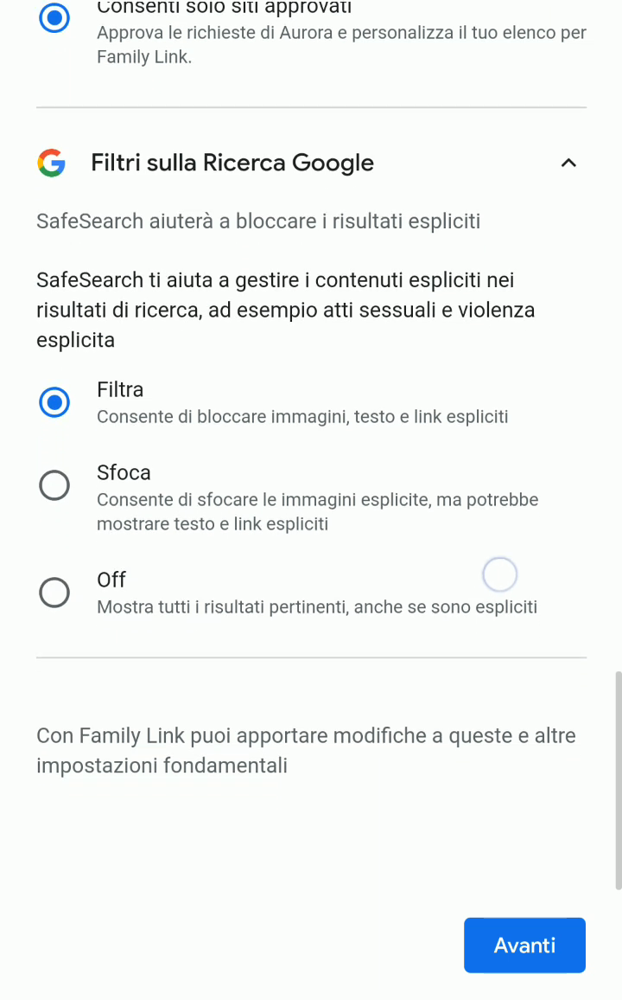
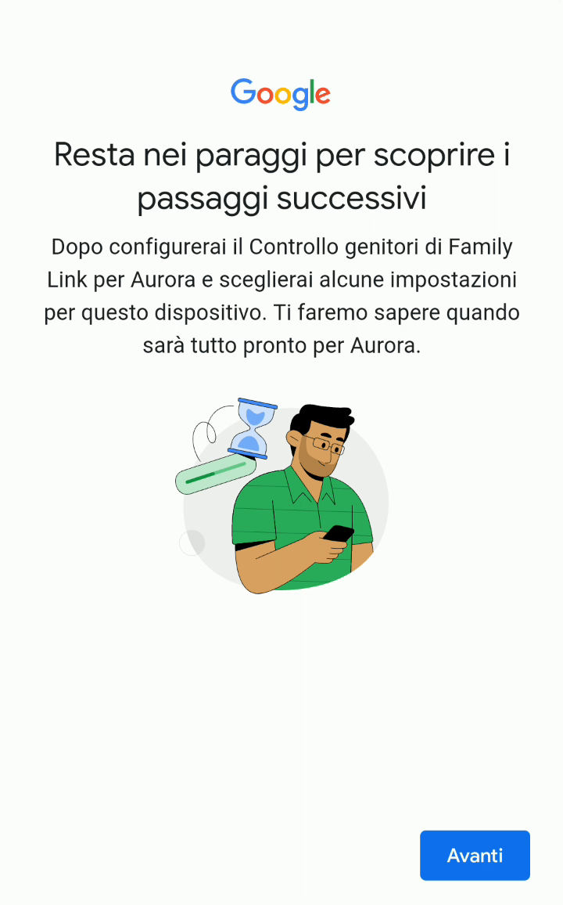

# Filtrare siti web su Chrome e risultati di ricerca Google

Dopo aver impostato i limiti per il Play Store, la prima configurazione prosegue con i filtri dedicati alla navigazione web su Google Chrome e ai risultati del motore di ricerca Google.

1. Le impostazioni nella sezione **Filtri su Google Chrome** riguardano i siti a cui il figlio/a ha accesso mentre usa Google Chrome (il browser di default della maggior parte dei telefoni Android). Si possono consentire tutti i siti web senza applicare restrizioni, bloccare i siti identificati da Google con contenuti espliciti o violenti, oppure stabilire che ogni volta che viene visitato un nuovo sito web tu genitore dovrai acconsentirne l’accesso, usando il tuo cellulare o quello di tuo figlio/a.

   

2. Infine, nella sezione **Filtri sulla Ricerca Google** (SafeSearch), devi scegliere come gestire le ricerche che restituiscono risultati espliciti. Puoi decidere di bloccare tutto (**Filtra**), sfocare le immagini che riguardano risultati espliciti (**Sfoca**), o non applicare nessuna restrizione con **Off**.

   

3. La configurazione continua, chiedendoti di pazientare ancora un po’ e tenerti pronto per fare altre configurazioni (non molte ancora, per fortuna). Seleziona **Avanti**.

   

4. Attendi un istante mentre il telefono salva e prepara i passaggi successivi.

   
