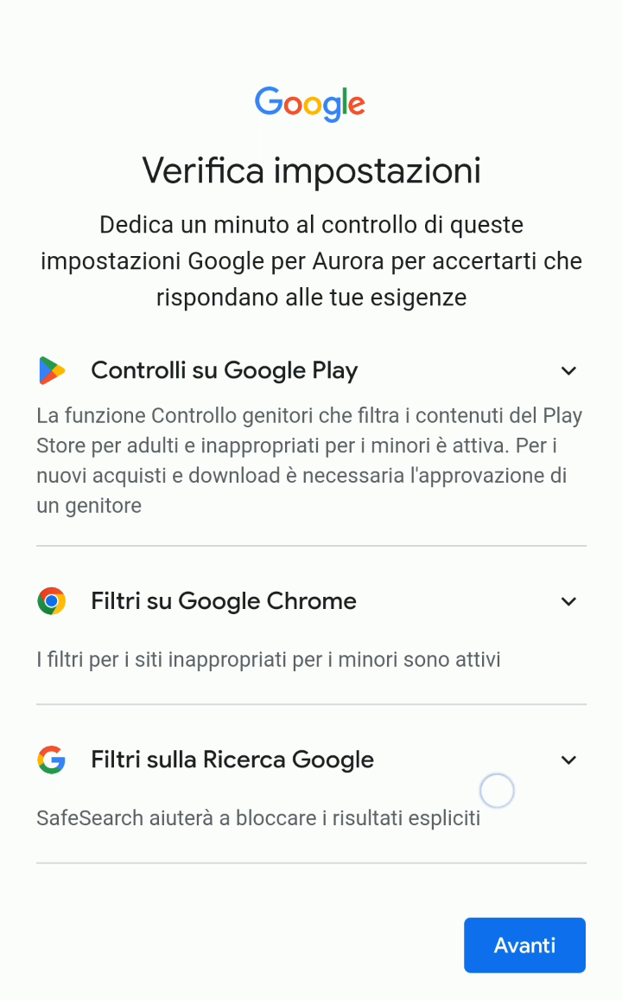
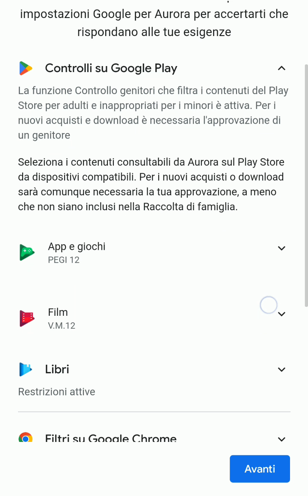
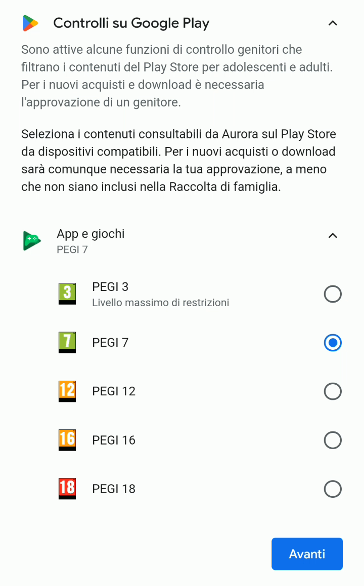
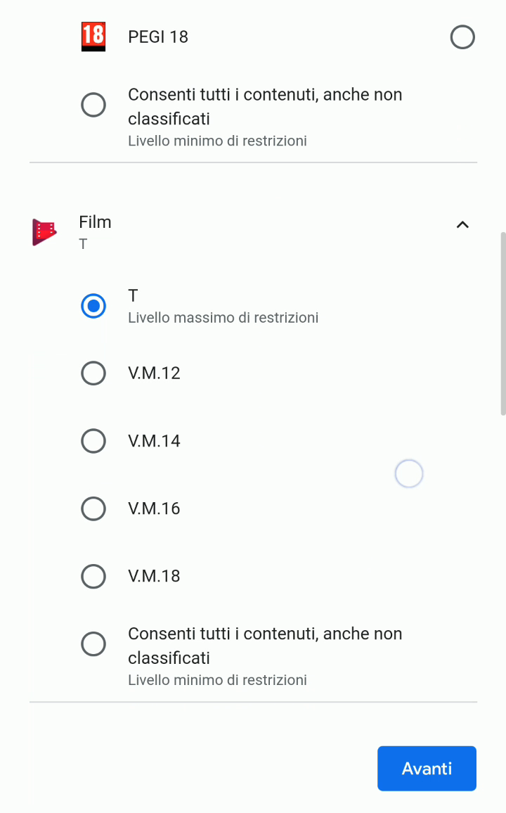
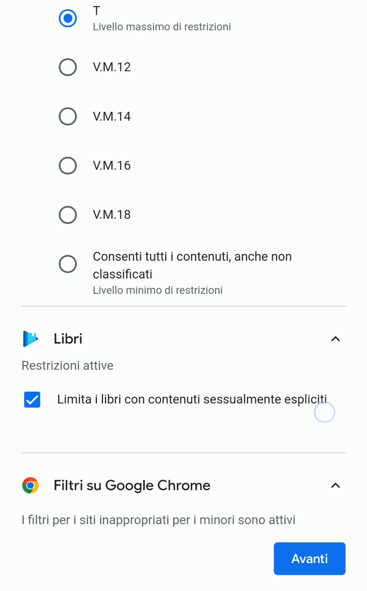

# Limitare app, film e libri su Google Play in base all'età

Le configurazioni iniziali sul cellulare sono molto importanti e servono per impostare a che tipo di contenuti, applicazioni e ricerche su Google vostro figlio/a avrà accesso.

Ci sono quattro gruppi di impostazioni disponibili:

1. Quelle relative alle applicazioni visibili e installabili da Google Play.
2. Quelle sui siti che tuo figlio/a potrà aprire su Chrome (il browser pre-installato sul cellulare).
3. Quelle che definiscono che tipo di risultati di ricerca verranno restituiti da Google.
4. Quelle relative all’uso di YouTube Kids o di YouTube, e l’età minima richiesta per i video disponibili.

> [!TIP]
> Tutte assieme queste impostazioni possono sembrare davvero tante da fare, e non sempre di immediata comprensione. Vengono richieste solo la prima volta che si usa l’account del proprio figlio/a per configurare un cellulare o tablet, e come tutte le configurazioni potrai cambiarle in un secondo momento tramite l’app Family Link sul tuo cellulare genitore. Potrai quindi fare più prove, senza spendere ore per cercare di capire tutte le scelte disponibili in questa fase iniziale, e trovare la situazione ideale per tuo figlio/a dopo qualche tentativo.

## Configurare i controlli su Google Play

1. Iniziamo con la schermata che raggruppa tre blocchi principali di contenuti: le applicazioni visibili e installabili da Google Play, i siti che tuo figlio/a potrà aprire su Chrome (il browser pre-installato sul cellulare) e che tipo di risultati di ricerca verranno restituiti da Google.

   

2. Ogni contenuto su Google Play (applicazioni, film e libri) definisce un’età minima necessaria per fruirne. I **Controlli su Google Play** permettono a te genitore di impostare fino a che fascia di contenuti tuo figlio/a può avere accesso.

   

3. **App e giochi** serve per far vedere, e quindi poter installare, solo certe applicazioni e giochi dal Google Play Store. Per esempio, se imposti un livello **PEGI 7** sull’account di tuo figlio/a, tutte le app che sono PEGI 12, 16 o 18 non verranno visualizzate nel Play Store, e di conseguenza non potranno essere installate.

   

4. **Film** segue lo stesso approccio, ma per i film e cartoni presenti sul Google Play Store. Se imposti il livello **T**, tutti i film che sono vietati ai minori di 12 o più anni non saranno disponibili per tuo figlio/a. *Questo controllo riguarda solo il Google Play Store, e altri programmi potrebbero non tener conto di queste restrizioni nel mostrare i contenuti disponibili.*

   

5. Similmente per i **Libri**, con la possibilità di vietare contenuti espliciti nella ricerca di libri e riviste sul Google Play Store.

   
