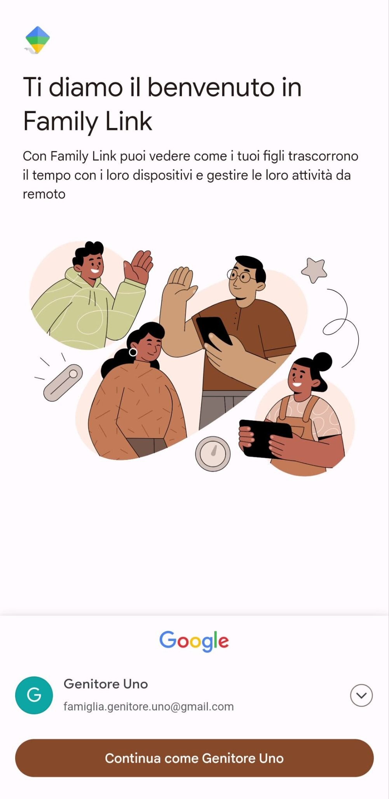

# Creare il Gruppo Famiglia e installare l'app sul telefono del genitore

Per gestire le impostazioni del Controllo genitori e monitorare l'attività di tuo figlio, la prima cosa da fare è **creare un Gruppo Famiglia**, al quale sono agganciati almeno un account genitore, e almeno un account figlio/a. Occorre farlo tramite l'app Family Link.

## Installare l'app Family Link

Nonostante sia necessario avere un cellulare Android per il proprio figlio/a, tu genitore puoi installare Family Link sia sul tuo cellulare Android, che iOS. L'importante è che tu abbia un [account Google](https://support.google.com/accounts/answer/27441) (*in genere termina con @gmail.com*) prima di iniziare.

### Genitore con cellulare Android

Scarica ed installa l'app Google Family Link dal [Google Play Store](https://play.google.com/store/apps/details?id=com.google.android.apps.kids.familylink&hl=it).

### Genitore con cellulare iPhone

Scarica ed installa l'app Google Family Link dall'[Apple App Store](https://apps.apple.com/it/app/google-family-link/id1150085200).

## Aprire l'app e configurare l'account genitore

Una volta scaricata e installata, apri l'app Family Link sul tuo dispositivo.

Nell'immagine sopra, ho usato [famiglia.genitore.uno@gmail.com](mailto:famiglia.genitore.uno@gmail.com) come account di uno dei genitori, ma tu devi usare il tuo account `@gmail.com`. Se è la prima volta che usi l'app, ti verrà chiesto di accettare i termini di servizio e l'informativa sulla privacy. Leggi attentamente e accetta per continuare.

Una volta impostato il Gruppo Famiglia, puoi continuare con l'aggiunta di un account figlio.
