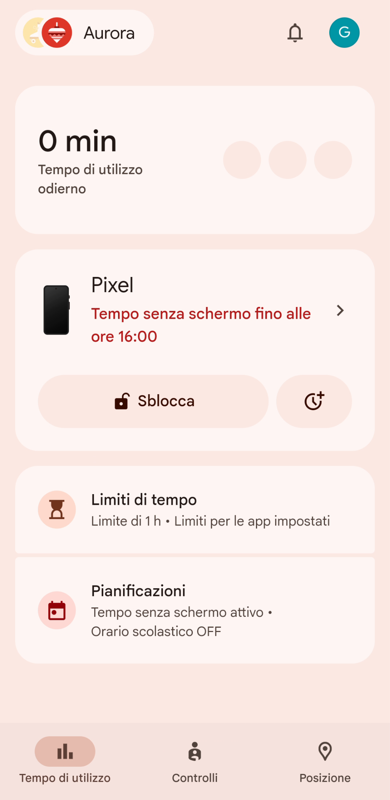
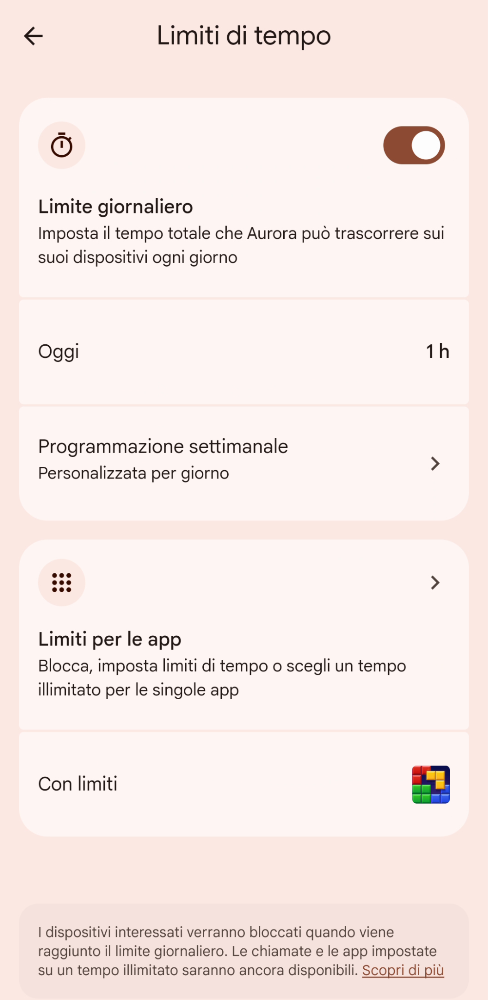
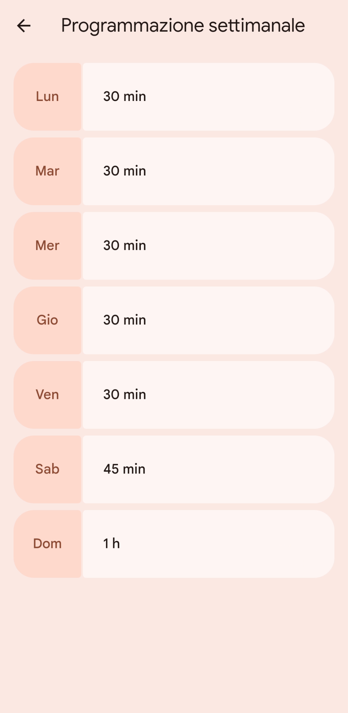
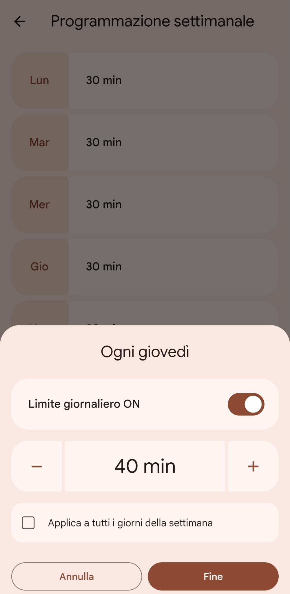
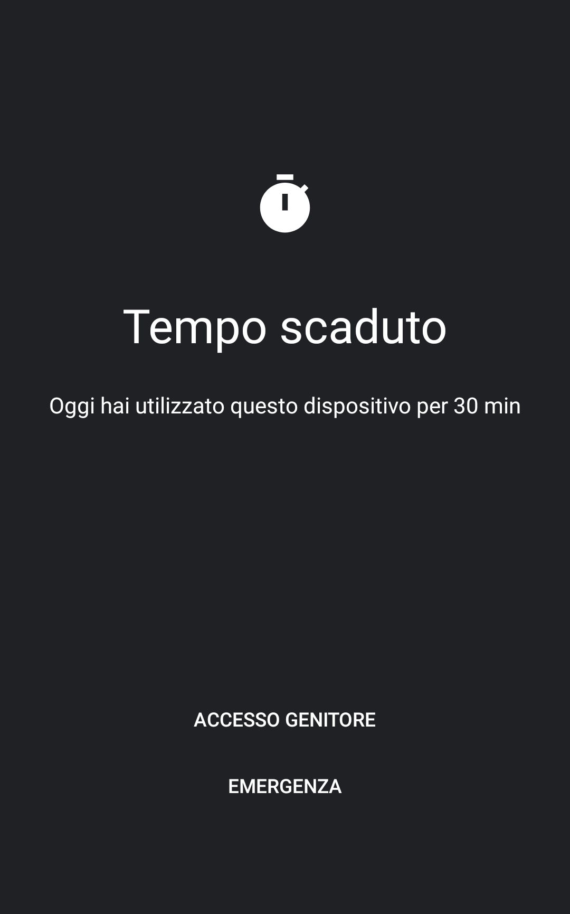

# Impostare un limite di tempo massimo di utilizzo giornaliero

I limiti di tempo di utilizzo permettono di impostare quanto tempo tuo figlio/a può trascorrere sul suo cellulare/tablet, promuovendo un equilibrio tra l’utilizzo del dispositivo e le altre attività.

Tuo figlio/a riceverà una notifica quando il limite sta per essere raggiunto e quando il dispositivo viene bloccato. Da quel momento in poi, l’accesso alle app e alle notifiche sarà bloccato, ad eccezione delle [app sempre consentite](./limiti-tempo-per-app.md), ricevere chiamate ed effettuare chiamate di emergenza (se il cellulare ha una SIM).

[Tempo senza schermo](./tempo-senza-schermo.md) definisce in che fascia oraria tuo figlio/a può usare il suo cellulare/tablet. Il Limite di tempo definisce per quanto tempo al massimo lo potrà usare, all’interno di quella fascia oraria.
Usando queste due impostazioni in maniera combinata, potrai quindi impostare, per esempio, che nei giorni settimanali tuo figlio/a potrà usare il suo cellulare tra la merenda e la cena, al massimo per 45 minuti.

1. Apri l’app Family Link sul tuo cellulare genitore, e seleziona il tab “Tempo di utilizzo”. Qui puoi vedere quanto tempo tuo figlio/a ha già passato sul cellulare. Seleziona “Limiti di tempo”.

   

2. Seleziona “**Programmazione settimanale**” per cambiare il tempo che, ogni giorno, tuo figlio/a può usare il cellulare.

   

3. I valori che trovi qui sono quelli impostati quando hai configurato l’account di tuo figlio/a sul cellulare. Ad esempio, puoi selezionare “Giovedì” e aggiungere più tempo.

   

4. Puoi sia impostare che ci sia un limite giornaliero da rispettare, attivando la voce “**Limite giornaliero ON**”, sia il tempo totale per la giornata. Disattivare il limite giornaliero significa che il cellulare può essere usato senza restrizioni di tempo. Verranno comunque rispettate le [fasce orarie di utilizzo](./tempo-senza-schermo.md), se impostate. Puoi anche decidere di applicare lo stesso limite a tutti gli altri giorni della settimana, selezionando “**Applica a tutti i giorni della settimana**”. Quando hai impostato i dati come preferisci, seleziona “**Fine**” per applicare le nuove impostazioni.

   

5. Se selezioni “**Oggi**” puoi impostare un nuovo limite di tempo solo per la giornata odierna, che non modificherà i limiti già definiti. Utile per gestire delle eccezioni, ad esempio del tempo extra che sai che servirà solo oggi.

   

6. Quando il limite di utilizzo giornaliero sarà raggiunto, questo è quello che vedrà tuo figlio/a sul suo cellulare. A meno che non siano presenti [applicazioni senza limite di utilizzo](./limiti-tempo-per-app.md), sarà impossibile per tuo figlio/a usare ulteriormente il cellulare.

   
