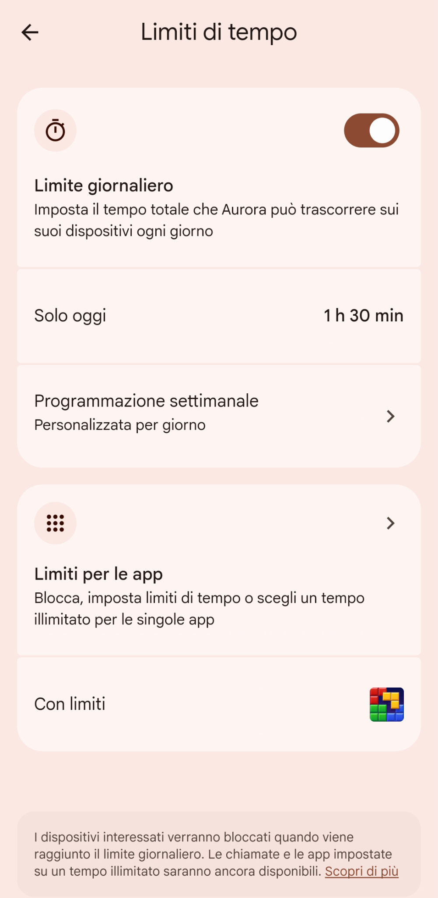
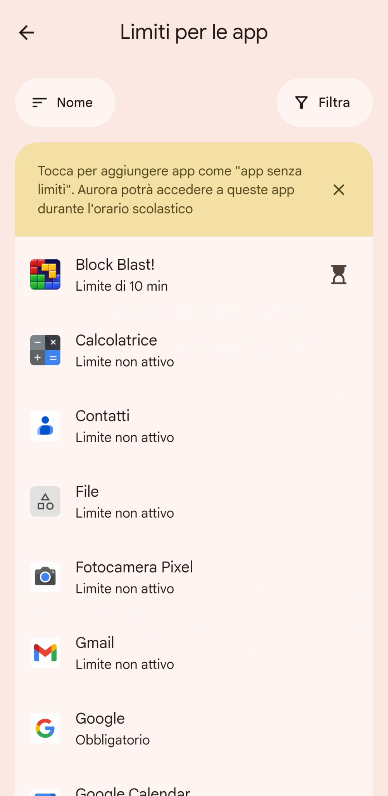
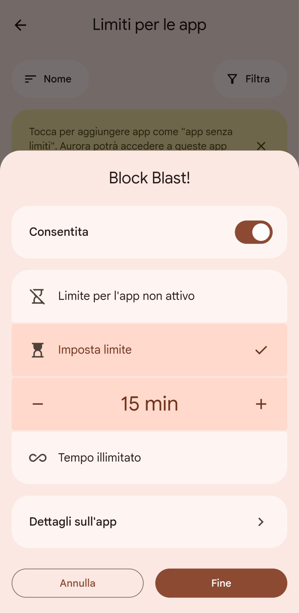
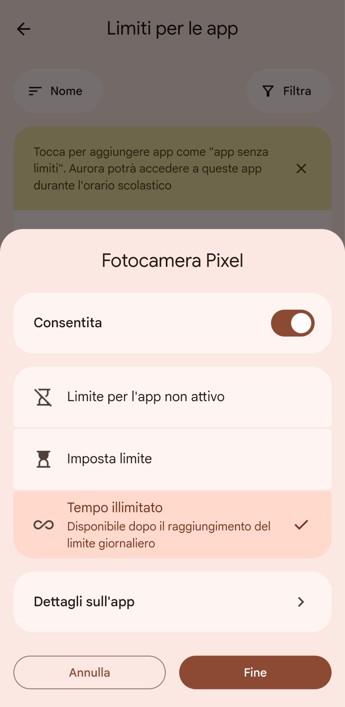
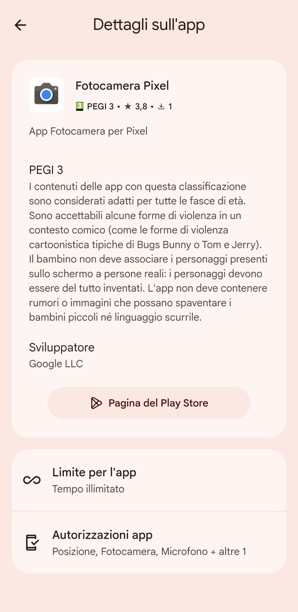
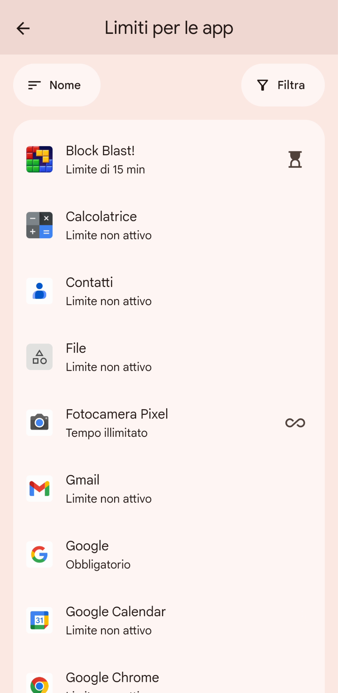
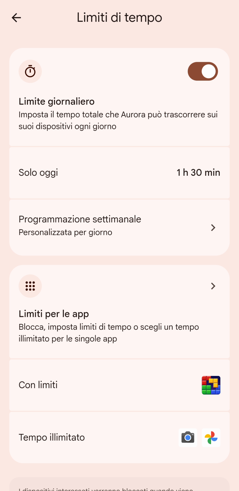
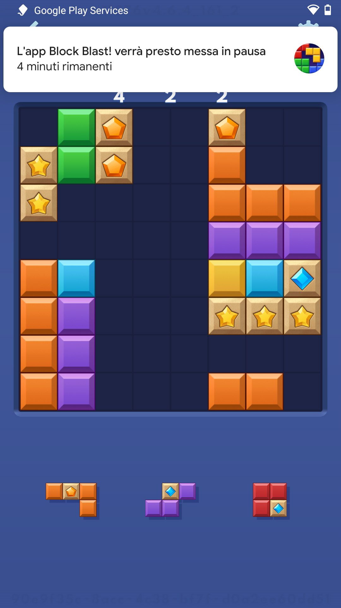
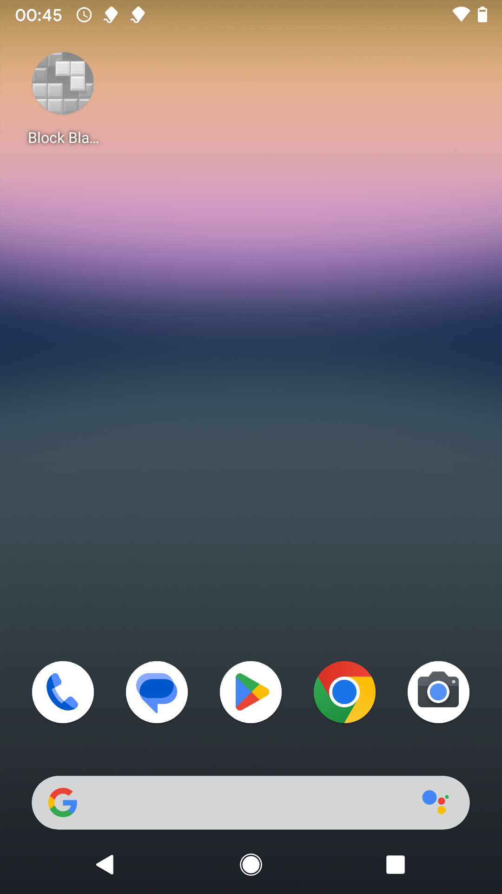
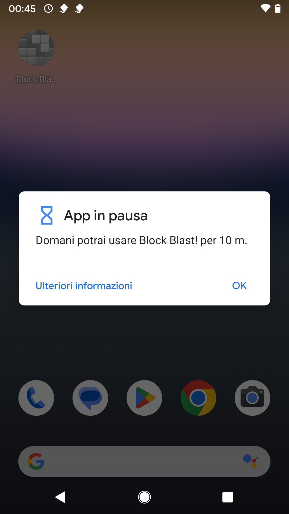

# Assegnare tempi di utilizzo diversi per singola applicazione

Quando si imposta un [limite di tempo giornaliero](./limite-tempo-giornaliero.md) per il dispositivo, tuo figlio/a decide in autonomia come usare quel tempo a sua disposizione, tra tutte le app a cui ha accesso. Cosa fare, però, per “restringere” ad un tempo massimo l’uso di particolari app, oppure rendere sempre possibile l’uso di altre?

Oltre ad impostare un limite di utilizzo giornaliero per il cellulare di tuo figlio/a (o non impostare limiti), è possibile definire un **tempo di utilizzo specifico per ogni app**.

- **Limite per l’app non attivo**: si applicano i normali limiti di tempo del cellulare. L’app potrà essere usata ogni giorno al massimo per lo stesso tempo che tuo figlio/a può usare il suo cellulare. Questa è l’impostazione predefinita per tutte le app, e permette a tuo figlio/a di decidere in autonomia come usare il tempo che ha a disposizione.
- **Tempo limitato**: l’app potrà essere usata al massimo per un certo tempo. Ad esempio, tuo figlio/a potrà accedere per 15 minuti al suo gioco preferito, pur potendo usare il cellulare per un’ora al giorno (*o potendolo sempre usare*).
- **Tempo illimitato**: l’app potrà sempre essere utilizzata e non contribuirà al limite di tempo del cellulare. Ad esempio, tuo figlio/a potrà sempre usare l’applicazione per fare le foto, o quella per esercitarsi con le operazioni di matematica, per tutto il tempo che vuole.

1. Apri l’app Family Link sul tuo cellulare genitore, e seleziona il tab “Tempo di utilizzo”. Qui puoi vedere quanto tempo tuo figlio/a ha già passato sul cellulare. Seleziona “Limiti di tempo”.

   

2. Seleziona “**Limiti per le app**”.

   

3. In questa lista puoi controllare tutti i limiti per le app impostati. Nell’esempio sotto, “**Block Blast!**” ha un limite di tempo specifico impostato. Seleziona l’app per modificare.

   

4. Qui puoi innanzitutto impostare che è possibile usare l’app sul cellulare di tuo figlio/a, selezionando “**Consentita**”. Con “**Limite per l’app non attivo**” le stesse eventuali restrizioni d'uso di tempo del cellulare si applicano anche all’app. Con “**Imposta limite**” puoi impostare il tempo massimo di utilizzo giornaliero dell’app. Nell’esempio sotto, “Block Blast!” può essere usata solo per 15 minuti al giorno.

   

5. Adesso seleziona “**Fotocamera Pixel**”, per poterla sempre usare senza limitazioni di tempo.

   

6. Scegli “**Tempo illimitato**” per non bloccare mai l’accesso all’app. Se vuoi avere maggiori informazioni sull’app, ti basta selezionare “**Dettagli sull’app**”.

   

7. Sono presenti tutta una serie di informazioni, tra cui l’età minima consigliata per usare l’app. In questo caso PEGI 3, quindi dai 3 anni in su, cioè adatta per tutte le fasce d’età.

   

8. Tornando alla lista dei “Limiti per le app”, l’icona alla destra di “Fotocamera Pixel” è cambiata, segnando un tempo illimitato di utilizzo.

   

9. Anche dalla schermata dei limiti di tempo, si può controllare velocemente quali sono le app con dei limiti di utilizzo specifici, e quelle con tempo illimitato di utilizzo.

   

10. Sul cellulare di tuo figlio/a, se un’app ha un limite di tempo di utilizzo, inizialmente appare questa notifica quando si sta per raggiungere il tempo massimo.

    

11. Poi l’app viene automaticamente chiusa al raggiungimento del tempo massimo di utilizzo, e la sua icona diventa grigia.

    

12. Se si prova a lanciare, un messaggio avverte tuo figlio/a che il limite di tempo d’uso giornaliero è stato raggiunto, e che bisogna attendere un ulteriore giorno per poter usare nuovamente l’app.

    
