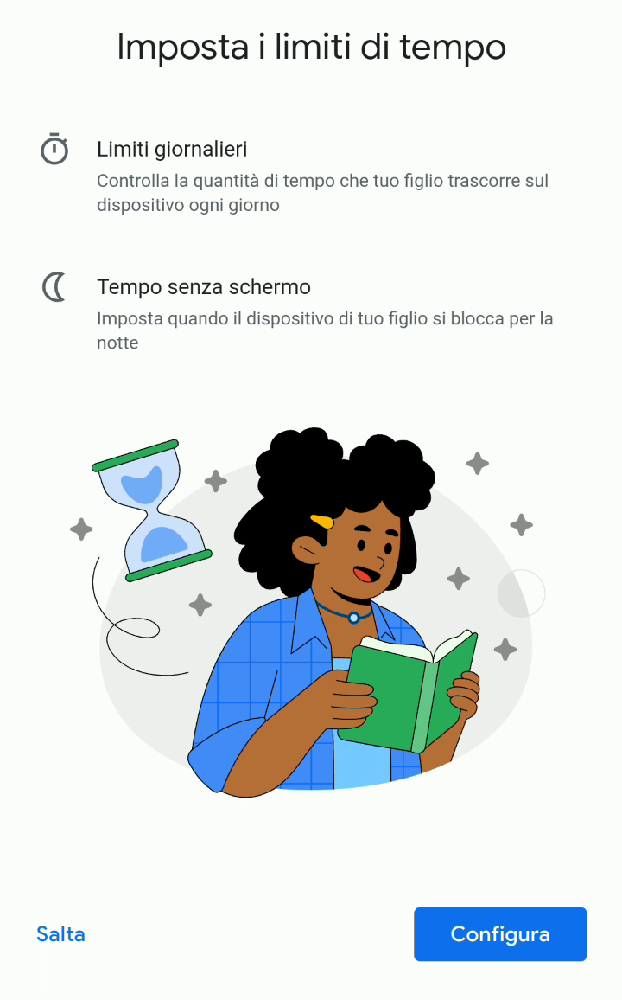
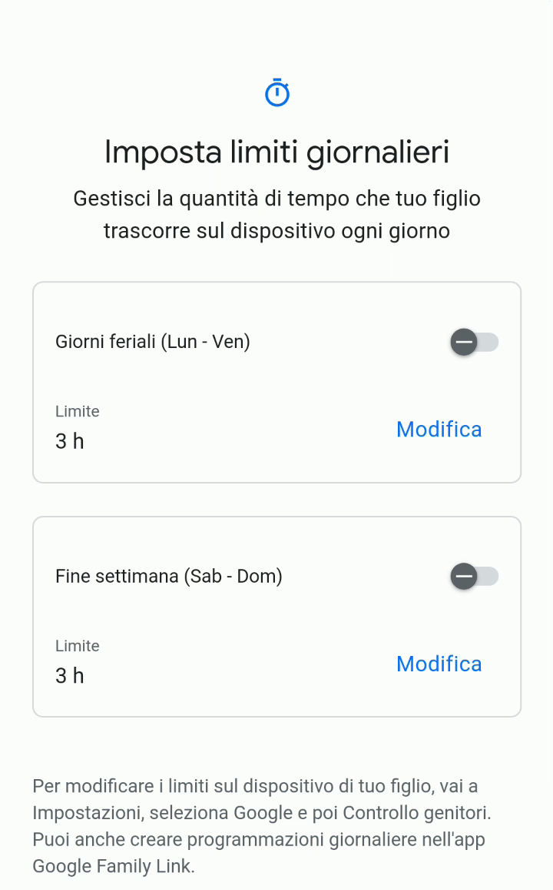
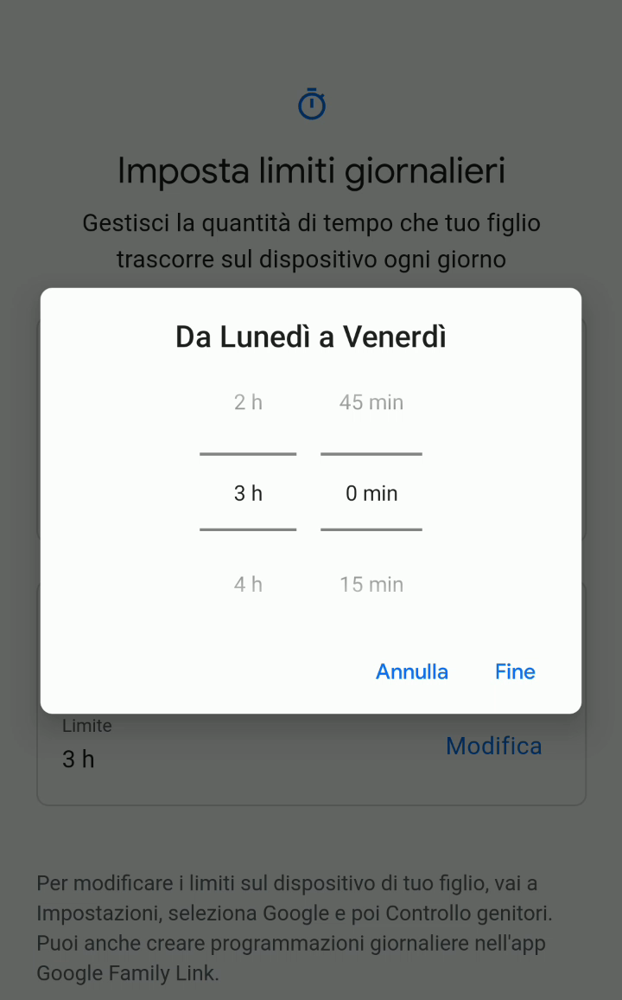
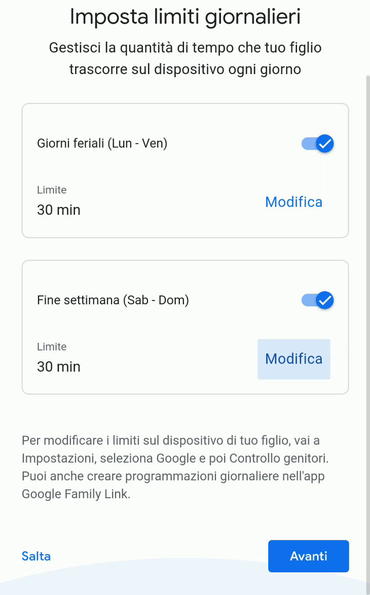
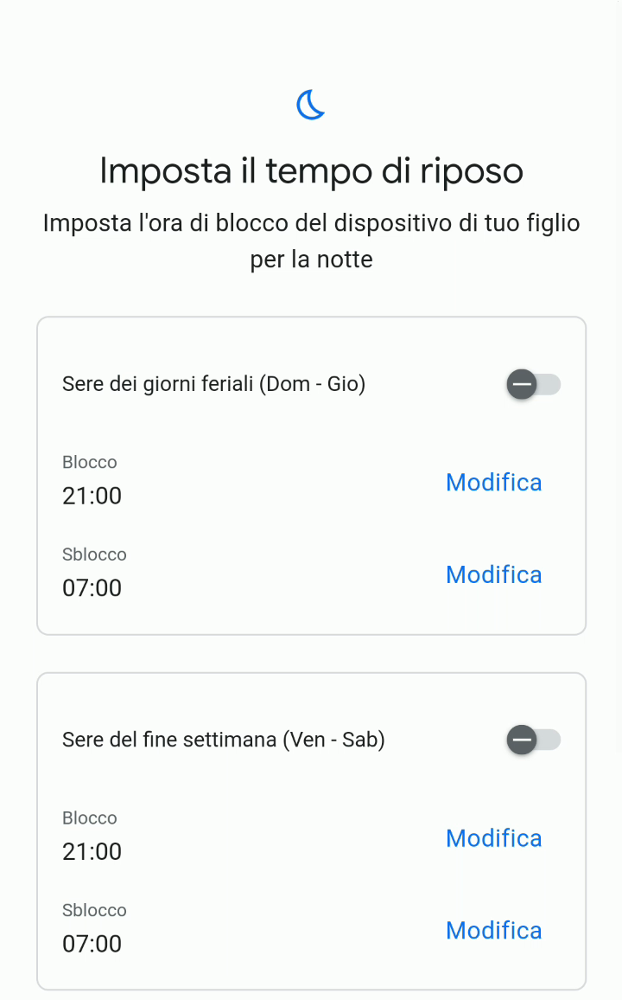
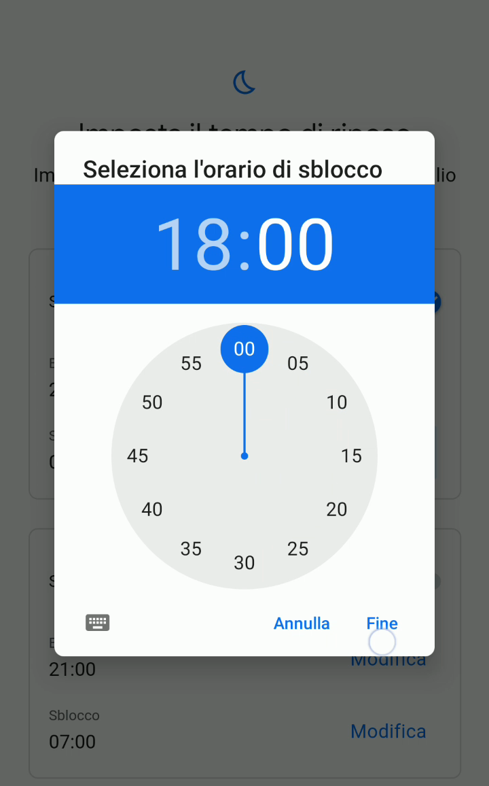
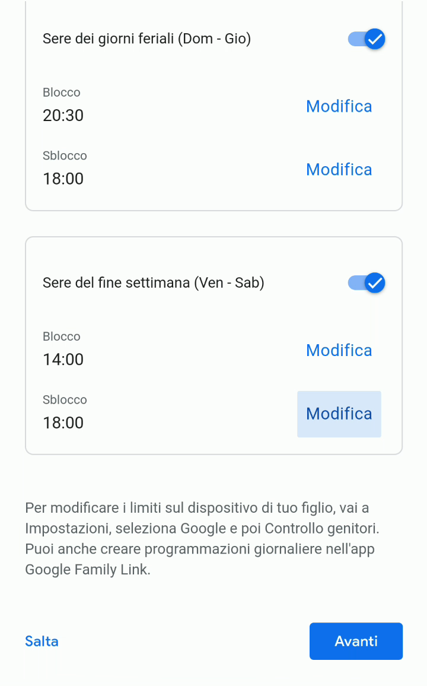

# Impostare limiti di tempo e fasce orarie durante la prima configurazione

Il penultimo gruppo di impostazioni permette di impostare dei limiti di tempo per l’utilizzo del cellulare: sia quanto tempo ogni giorno tuo figlio/a potrà utilizzare il dispositivo, sia in che fascia oraria potrà utilizzarlo.

1. Anche questo gruppo di configurazioni può essere saltato, ma questo significa non impostare nessun limite di utilizzo del cellulare, cosa che sconsiglio altamente. Premi “Configura” per impostare il tempo di utilizzo.

   

2. Scegli, inizialmente, se impostare un tempo massimo di utilizzo, distinguendo tra giorni feriali e fine settimana. Premi la levetta sulla destra per impostare il tempo.

   

3. Specifica ore e minuti massimi di utilizzo per ogni giorno.

   > [!TIP]
   > Dato che potrai sia cambiare questo limite, sia aggiungere del tempo bonus all’occorrenza, il mio consiglio è quello di partire con un tempo breve, e poi capire assieme, un po’ alla volta, la quantità davvero adatta alle esigenze di tuo figlio/a.

   

4. Una volta fatto sia per i giorni feriali, che per i fine settimana, premi “**Avanti**”.

   

5. Similmente a prima, adesso puoi impostare la fascia oraria in cui tuo figlio/a potrà usare il cellulare.

   

6. Imposta sia l’orario di blocco, che di sblocco, sia per i giorni feriali, che per quelli festivi.

   

7. Controlla le fasce orarie immesse, e poi premi “Avanti”.

   

In seguito potrai modificare in qualsiasi momento queste impostazioni direttamente dall’app Family Link, regolando il [limite di tempo giornaliero](./limite-tempo-giornaliero.md) o le fasce di [tempo senza schermo](./tempo-senza-schermo.md).
