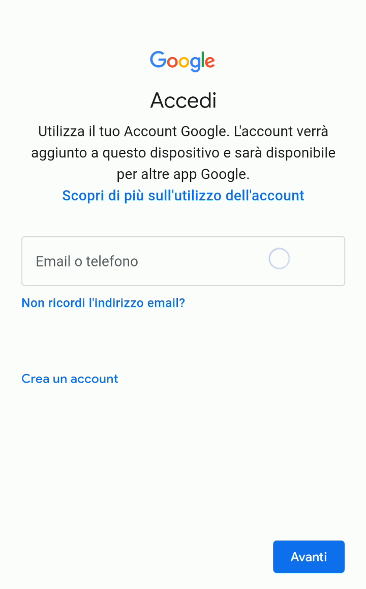
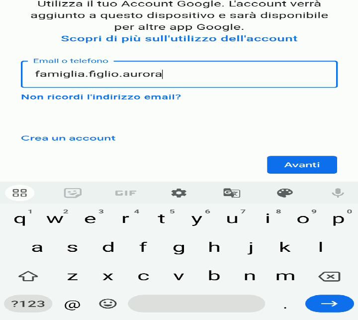
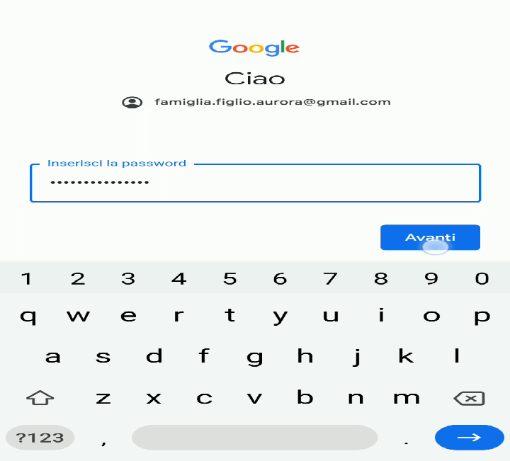
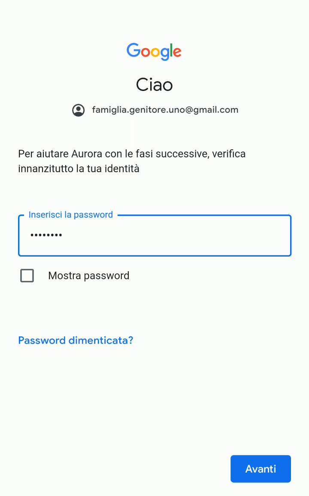
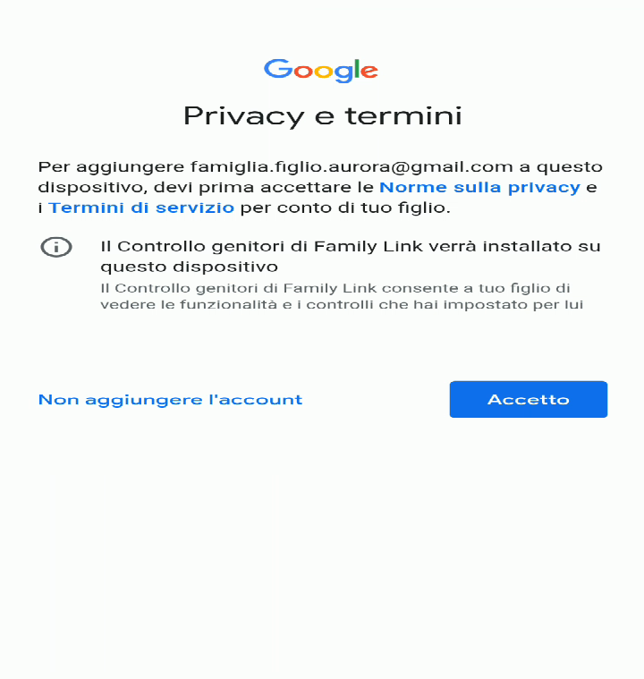

# Primo avvio e accesso sul cellulare Android del figlio

Con l’account per tuo figlio/a creato e [collegato ad un Gruppo Famiglia](./installazione-app-genitore.md), adesso è possibile configurare il suo cellulare o tablet.

> [!NOTE]
> Io consiglio di partire con un cellulare “pulito”, come nel caso di un dispositivo nuovo e ancora mai configurato, oppure perché è stato fatto un [ripristino dei dati di fabbrica](https://support.google.com/android/answer/6088915). È comunque possibile aggiungere l’account figlio/a dalle impostazioni del dispositivo anche su un telefono già funzionante e in uso, preservando i dati (come le foto) già memorizzati nel dispositivo, e procedere poi allo stesso modo.

Solitamente, quando si configura per la prima volta un cellulare Android, dopo la selezione della lingua e la connessione a una rete Wi-Fi, viene chiesto quale account Google utilizzare con il cellulare.

1. La prima informazione richiesta per configurare il cellulare è l’account del figlio/a da usare.

   

2. Bisogna usare l’account figlio/a che hai creato precedentemente. *Nell’esempio, io ho usato `famiglia.figlio.aurora@gmail.com`*. Poi seleziona **Avanti**.

   

3. Immetti la password scelta precedentemente per l’account di tuo figlio/a. Poi seleziona **Avanti**.

   

4. Adesso, per completare la configurazione del cellulare, occorre che tu genitore faccia alcune scelte su come tuo figlio/a potrà usare il cellulare. Per questo viene chiesto di verificare la propria identità di genitore, scegliendo tra uno degli account che gestisce il gruppo famiglia al quale il figlio/a appartiene. Vengono presentate le scelte disponibili. *Nel mio caso, c’è solo un genitore ed è `famiglia.genitore.uno@gmail.com`*.

   

5. Per essere sicuri che sia veramente tu il genitore, ti viene richiesta la password del tuo account da genitore. Inseriscila e poi seleziona **Avanti**.

   

6. Ti viene richiesto di accettare norme sulla privacy e termini di servizio. Leggile e poi usa il bottone **Accetto** per continuare.

   
