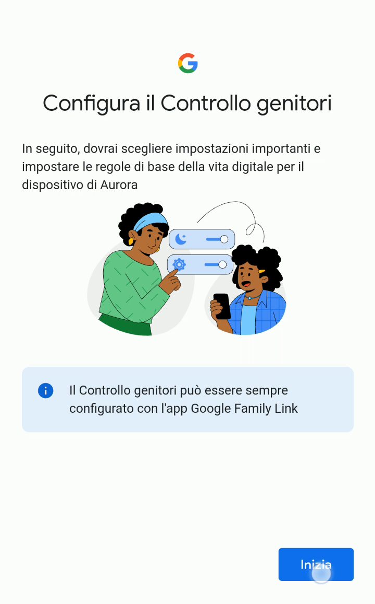
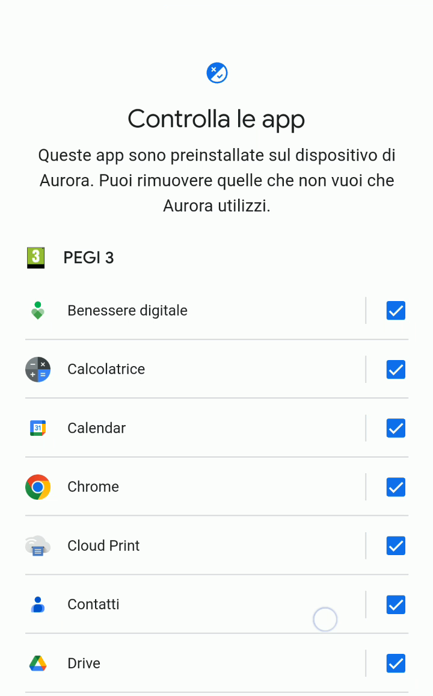
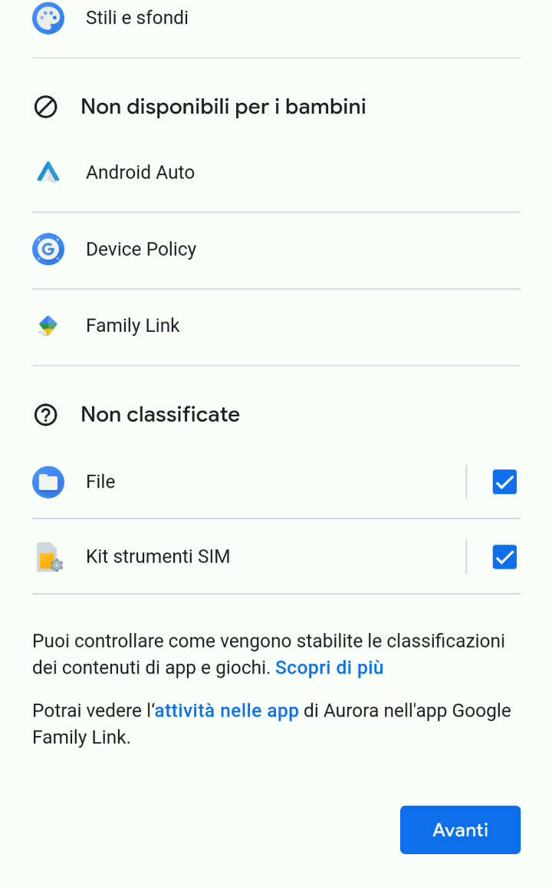

# Gestire le app già preinstallate sul cellulare

Pur avendo impostato precedentemente l’età minima richiesta per le applicazioni che tuo figlio/a potrà installare dal Play Store, tutti i telefoni hanno delle app preinstallate, ed alcuni modelli sono molto più “zelanti” di altri su quello che si trova già a bordo del dispositivo. Potrebbero già esserci installate app come Facebook, WhatsApp, YouTube o diversi giochi. E da genitore, non vorresti che tuo figlio/a usasse queste app.

Grazie alle prossime configurazioni, potrai decidere a quali app e giochi preinstallati tuo figlio/a avrà accesso. Questi passi verranno richiesti ogni volta che configuri un dispositivo per usare l’account di tuo figlio/a.

1. Anche in questo caso, potrai cambiare le successive configurazioni in un secondo momento tramite l’app Family Link dal tuo cellulare genitore.

   

2. Ti viene mostrata una lista contenente tutte le app già preinstallate sul cellulare. Ovviamente l’elenco cambia da un cellulare all’altro. Il mio consiglio è dare un’occhiata e **togliere il segno di spunta** a quelle app a cui non vogliamo dare accesso a nostro figlio/a.

   

3. Completata la scelta delle app, seleziona **Avanti**.

   
