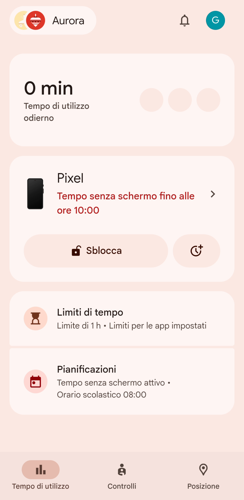
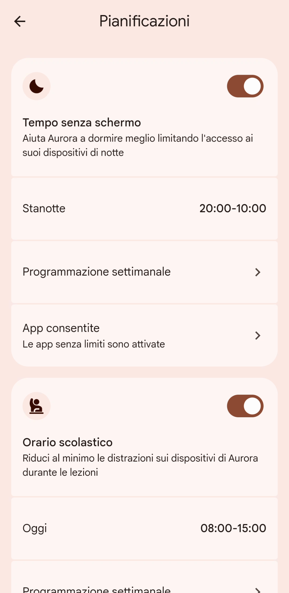
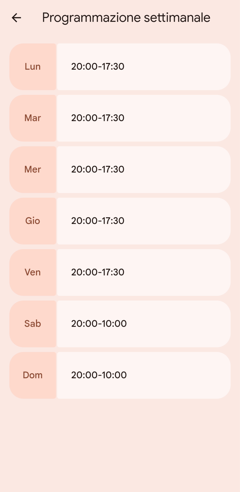
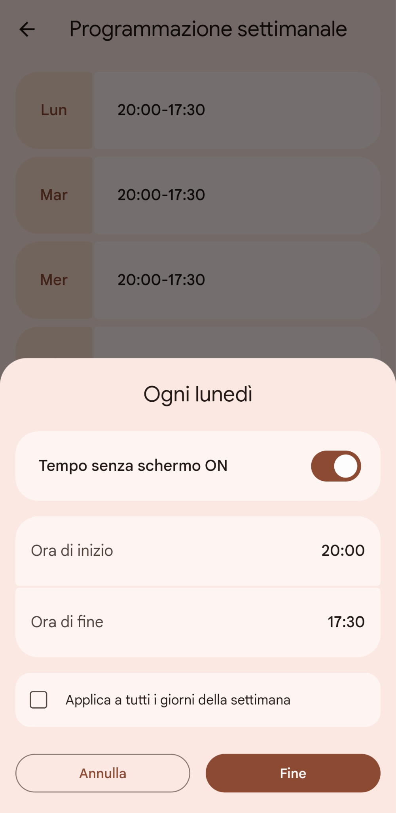
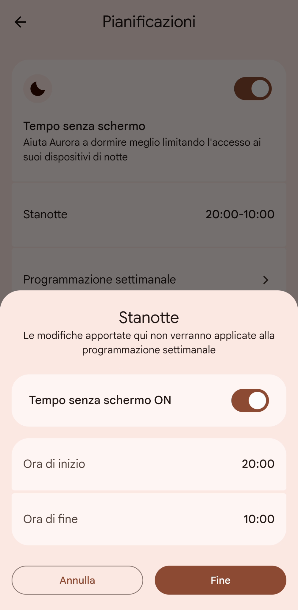
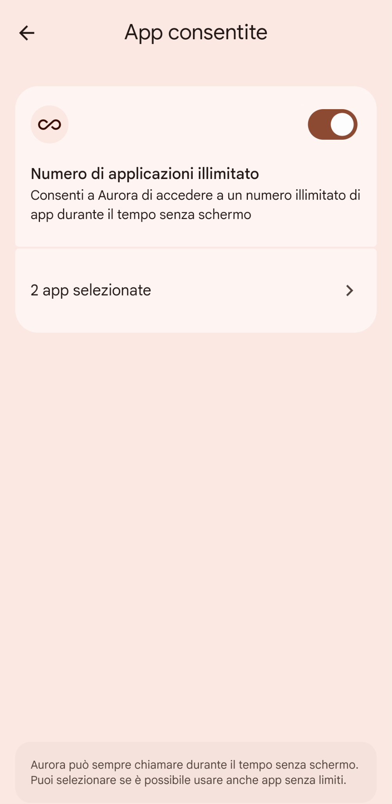
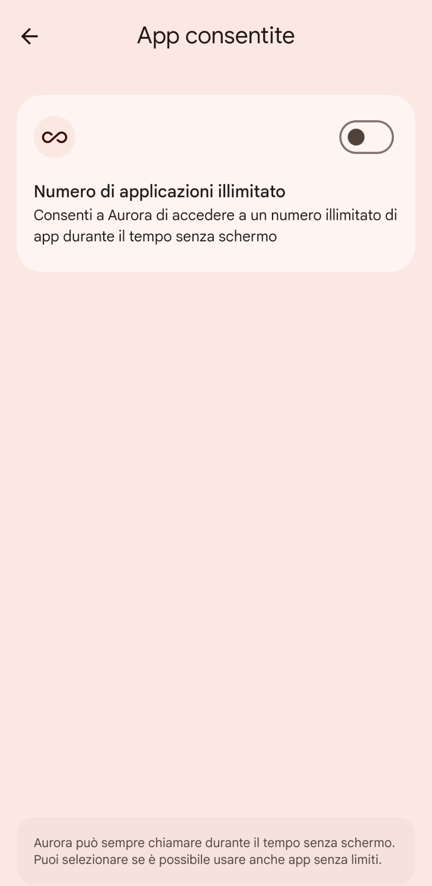

# Impostare le fasce orarie di blocco con Tempo senza schermo

Per ridurre le distrazioni di notte o durante l'orario scolastico, puoi impostare il dispositivo di tuo figlio/a in modo che non sia usabile in una certa fascia oraria, o sia usabile solo con certe [app sempre consentite](./limiti-tempo-per-app.md). Come per i limiti di tempo, è sempre possibile per tuo figlio ricevere chiamate ed effettuare chiamate di emergenza (se il cellulare ha una SIM).

“Tempo senza schermo” definisce in che fascia oraria tuo figlio/a può usare il suo cellulare/tablet. Il [Limite di tempo](./limite-tempo-giornaliero.md) definisce per quanto tempo al massimo lo potrà usare, all’interno di quella fascia oraria.
Usando queste due impostazioni in maniera combinata, potrai quindi impostare, per esempio, che nei giorni settimanali tuo figlio/a potrà usare il suo cellulare tra la merenda e la cena, al massimo per 45 minuti.

1. Per impostare un tempo senza schermo, scegli “Tempo di utilizzo”, e poi “Pianificazioni”.

   

2. Nello schermo di gestione principale puoi attivare e disattivare il “Tempo senza schermo”, controllare l’impostazione per il giorno corrente, modificare la “Programmazione settimanale” e decidere se tuo figlio/a può comunque avere accesso a certe app anche durante il tempo senza schermo. Vedremo poi la parte dell’[orario scolastico](./orario-scolastico.md). Abilita “**Tempo senza schermo**” e seleziona “**Programmazione settimanale**”.

   

3. Qui puoi controllare in che fascia oraria di ogni giorno tuo figlio/a non potrà usare il cellulare. Nell’esempio che segue, volevo che il cellulare si potesse usare solo dalle 17:30 alle 20:00 dal lunedì al venerdì, e dalle 10:00 alle 20:00 per il weekend. Ho quindi impostato il Tempo senza schermo che inizia alle 20:00, e che finisce alle 17:30 per i giorni infrasettimanali. Inizio 20:00 e fine 10:00 per i weekend.

   

4. Selezionando un giorno della settimana, puoi gestire il tempo senza schermo specifico per quel giorno, e decidere anche di disabilitarlo completamente.

   

5. Se selezioni “**Stanotte**” nello schermo di gestione principale, puoi impostare un limite di tempo che si applica solo al giorno corrente, senza andare a modificare la pianificazione. Comodo per gestire eccezioni conosciute in anticipo.

   

6. Infine, se scegli “**App consentite**” nello schermo di gestione principale, puoi decidere se le app che NON hanno un limite di tempo possono essere usate anche mentre il cellulare è nel suo tempo senza schermo. Se scegli “**xx app selezionate**”...

   

7. … puoi controllare quali sono le app che si possono utilizzare anche durante il tempo senza schermo, ed eventualmente cambiare i loro limiti di tempo.

   

8. Se nelle impostazioni delle app consentite disabiliti “**Numero di applicazioni illimitato**” (*oppure non hai impostato app senza limiti di tempo*), allora tuo figlio/a potrà solo ricevere telefonate ed effettuare chiamate di emergenza durante il tempo senza schermo.

   
